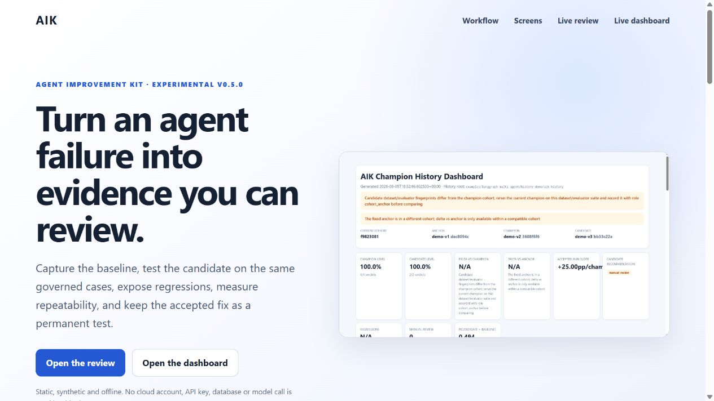

# AIK — Agent Improvement Kit

[](https://github.com/mahdimor/AIK/actions/workflows/ci.yml)
[](LICENSE)
[](https://www.python.org/)

> **Project status:** experimental `v0.5.1`. AIK is usable for local evaluation
> workflows, but its statistical gates are supporting evidence—not a sole
> production-release criterion. File formats and CLI details may change before
> `v1.0`.

AIK is a small, local-first Agent Skill that turns an AI-agent failure into governed test data, independently evaluated before/after evidence, an explicit acceptance recommendation, and a permanent regression test.

It is not a hosted observability platform and does not embed an agent SDK. The core executes project-owned runners, applies deterministic evaluators, delegates optional semantic judgment through a provider-neutral subprocess protocol, and enforces acceptance gates. No cloud account, database, framework SDK, or third-party Python dependency is required by AIK core.

## Why AIK

Agent changes are easy to ship and hard to prove. AIK keeps the failure, baseline,
candidate, evaluator configuration, acceptance policy, repeated trials, human
decision, and promoted regression cases together as reviewable files. It complements
observability and optimization tools; it does not replace production monitoring,
real user feedback, or release ownership.



## Visual tutorial

Build the complete static tutorial from committed synthetic evidence:

```bash
python scripts/build_showcase.py
python -m http.server 8000 --directory dist/showcase
```

Open `http://127.0.0.1:8000`. The tutorial links to a live standalone review and
champion dashboard, makes no model or network call, and needs no API key. Read the
[step-by-step tutorial](docs/TUTORIAL.md) or inspect the source under `showcase/`.

## Install

AIK core is source-distributed and uses only the Python standard library:

```bash
git clone https://github.com/mahdimor/AIK.git
cd AIK
python aik.py --version
python aik.py demo
```

To use only the portable Agent Skill, copy
`.agents/skills/improve-agent/` into a repository that supports the Agent Skills
layout. The CLI remains available for hosts that do not discover skills. AIK does
not require Azure, OpenAI, LangGraph, Langfuse, or any other provider; the LangGraph
and OpenAI integrations are optional examples.

## Try it in one command

Requires Python 3.10 or newer.

```bash
python aik.py demo
```

Then open:

```text
examples/support-agent/confirmation-before-action/review.html
```

The example intentionally contains one improvement and one regression, demonstrating that AIK never hides a regression behind a better average score.

## Use it on an agent change

1. Create a case:

   ```bash
   python aik.py init my-agent-failure
   ```

2. Describe the issue, add governed cases to `test_cases.jsonl`, and define evaluators and acceptance gates in `evaluation.json` before changing the agent.

3. Record the same cases before and after the change. Files can be written by an existing test harness, or generated through any project-owned command:

   ```bash
   python aik.py run improvements/my-agent-failure --stage baseline -- python path/to/my_runner.py
   # Change the prompt, model, tools, routing, or agent code.
   python aik.py run improvements/my-agent-failure --stage candidate -- python path/to/my_runner.py
   ```

   The runner may use MCP, an SDK, HTTP, a local model, or a deterministic mock. It returns raw evidence and does not need to decide `passed`. See [the runner protocol](.agents/skills/improve-agent/references/runner-protocol.md).

4. Evaluate both stages. Deterministic evaluation needs no external command:

   ```bash
   python aik.py evaluate improvements/my-agent-failure --stage baseline
   python aik.py evaluate improvements/my-agent-failure --stage candidate
   ```

   For semantic rubrics, pass any compatible judge command after `--`. The bundled optional OpenAI judge is one implementation:

   ```bash
   python aik.py evaluate improvements/my-agent-failure --stage candidate -- \
     python .agents/skills/improve-agent/scripts/openai_judge.py
   ```

5. Validate and generate the review:

   ```bash
   python aik.py validate improvements/my-agent-failure
   python aik.py review improvements/my-agent-failure
   ```

6. Open `review.html`, inspect the policy recommendation and every regression, then record the human decision in `decision.yaml`.

7. After acceptance, preserve improved cases as permanent regression tests:

   ```bash
   python aik.py promote improvements/my-agent-failure
   ```

Run `python aik.py --help` for all commands.

## Try the execution bridge

The bundled fake runner is deterministic and makes no network call:

```bash
python aik.py run examples/execution-bridge --stage baseline --overwrite -- python examples/runners/fake_agent.py
python aik.py run examples/execution-bridge --stage candidate --overwrite -- python examples/runners/fake_agent.py
python aik.py review examples/execution-bridge
```

Useful execution options:

- `--timeout 30`: limit each case;
- `--resume`: keep completed cases and run missing ones;
- `--overwrite`: intentionally replace the selected stage file;
- `--id case-id`: select an ID, repeatable;
- `--tag routing`: select cases sharing a tag, repeatable;
- `--cwd path`: run the command from a project directory.

## LangGraph multi-agent demo

AIK includes a real LangGraph example based on LangChain's official tool-based subagents pattern: one supervisor coordinates billing and technical specialists. The mock mode runs the complete graph and AIK workflow without an API key:

```bash
python -m pip install -r examples/langgraph-multi-agent/requirements.txt
python examples/langgraph-multi-agent/run_demo.py --mode mock
```

To use OpenAI for the agent, set `OPENAI_API_KEY` and replace `--mode mock` with `--mode openai`. To keep the mock agent but evaluate its semantic rubric with OpenAI, add `--judge openai`. See [the demo guide](examples/langgraph-multi-agent/README.md) and [the reusable adapter contract](.agents/skills/improve-agent/references/langgraph-adapter.md).

## Champion history and local dashboard

Preserve an evaluated campaign as immutable history, then generate a standalone local
dashboard that answers "are we better than before, is the candidate eligible, and did
anything regress" without opening raw JSON:

```bash
python aik.py history init improvements/my-agent-failure --stage baseline --label "Initial version" --agent-version v1
python aik.py history record improvements/my-agent-failure --stage candidate --label "Fix" --agent-version v2
python aik.py history promote <run-id>
python aik.py dashboard
```

Then open `aik-history/dashboard.html`. History recording never reruns an agent; it
only archives evidence Sprint 4 (`aik evaluate` / `aik review`) already produced.
Promotion requires a hash-verified, non-stale, cohort-compatible candidate with an
`eligible` recommendation and an accepted human decision — there is no bypass. See
[the history and dashboard reference](.agents/skills/improve-agent/references/history-dashboard.md).
Try the included demo:

```bash
python examples/langgraph-multi-agent/history-demo/build_history_demo.py
```

which archives the anchor, shows a pending decision correctly blocking promotion,
accepts and promotes the candidate, and generates
`examples/langgraph-multi-agent/history-demo/aik-history/dashboard.html`.

## Statistical reliability

One run cannot tell you whether an improvement is repeatable or agent/LLM-judge
noise. Repeat it and measure:

```bash
python aik.py run improvements/my-agent-failure --stage baseline --repetitions 5 -- python path/to/my_runner.py
python aik.py run improvements/my-agent-failure --stage candidate --repetitions 5 -- python path/to/my_runner.py
python aik.py evaluate improvements/my-agent-failure --stage baseline --trials
python aik.py evaluate improvements/my-agent-failure --stage candidate --trials
python aik.py reliability improvements/my-agent-failure
python aik.py review improvements/my-agent-failure
```

`--repetitions` defaults to `1` and is unchanged from Sprint 4/5 at that default.
`aik reliability` computes pass rate, a Wilson confidence interval, a deterministic
seeded bootstrap for the delta and `P(candidate > baseline)`, flaky cases, and
evaluator version incompatibilities — standard-library only, and it never converts a
missing or errored observation into a zero score. An optional `reliability` block in
`evaluation.json` can gate acceptance on this evidence, but a statistical result can
never override a deterministic rejection, and insufficient evidence can only push a
recommendation toward `manual_review`, never toward `eligible`. See
[the reliability reference](.agents/skills/improve-agent/references/statistical-reliability.md).
Try the included offline demo:

```bash
python examples/langgraph-multi-agent/history-demo/build_reliability_demo.py
```

which runs a small suite through the real runner bridge with `--repetitions`, computes
`reliability.json`, and shows a case that looks like a clean improvement on a single
run but is correctly withheld from promotion because the repeated trials do not meet
the configured probability threshold.

## A verdict on one case

The rest of AIK judges a version: is this candidate better than the champion? A
business reviewer needs the other object — a verdict on one dossier, the criteria
that decided it, and what to do next.

```bash
python aik.py judge improvements/my-agent-failure --case-id dossier-4711
```

```yaml
case_id: dossier-4711
judge: refund-policy-judge@0.1.0
verdict: escalate
score: 0.7
confidence: 1
criteria:
  policy_compliance: pass
  evidence_quality: fail
  consistency: pass
critical_violations: []
recommended_action: request_missing_evidence
```

No evaluator runs here: `aik judge` reads evidence `aik evaluate` already produced
and maps it onto weighted criteria, hard rules and a verdict vocabulary declared in a
`judge` block of `evaluation.json`.

A hard rule is a policy limit, not a quality signal — a delay window, an amount
ceiling, a mandatory approval. One violation forces `reject` whatever the score says,
because weighing a legal limit against a rubric is how a system approves something it
was never allowed to approve. A hard rule that could not be checked does not pass by
default either; the verdict becomes `insufficient_evidence`.

`confidence` is the share of criterion weight that produced a definite status —
coverage, not a probability that the verdict is right, and never a model's
self-reported certainty. See
[the domain judge reference](.agents/skills/improve-agent/references/domain-judge.md).

## Does the judge decide like your experts?

```bash
python aik.py agreement improvements/my-agent-failure
```

```text
judge vs consensus           kappa=0.812 [0.641, 0.938]  agreement=0.910  n=45
judge vs amina               kappa=0.789 [0.612, 0.921]  agreement=0.898  n=49
amina vs luc                 kappa=0.835 [0.658, 0.951]  agreement=0.920  n=25
NOTE: The judge (kappa 0.812) is inside the human band (experts agree with each
other at 0.835 or better).
```

Raw agreement flatters any judge on skewed data: if 90% of dossiers are approvals, a
judge that approves everything agrees 90% of the time and has learned nothing.
Cohen's kappa subtracts chance agreement, so that judge scores 0.

The number nobody reports is the second one — **how well the experts agree with each
other**. That is the ceiling: a judge cannot be more right than the humans are
consistent. A kappa of 0.72 is a failure if two experts agree at 0.95 and the end of
the road if they agree at 0.70. `aik agreement` computes every expert pair and says
which side of the band the judge is on; with a single rater it says there is no
ceiling instead of implying the number stands alone.

Contested cases are excluded and listed — experts disagreeing marks an ambiguous
policy, not a wrong judge. Abstentions are excluded and reported with the remaining
coverage, because a judge that abstains on everything hard scores well on what is
left. Every kappa carries a deterministic seeded bootstrap interval, and is `null`
with a reason rather than `1.0` when chance agreement is total. See
[the agreement reference](.agents/skills/improve-agent/references/agreement.md).

## Cost, latency and the constrained Pareto front

Quality alone cannot decide whether a task can move to a cheaper model. Rank
evaluated variants on quality, cost and latency at once:

```bash
python aik.py pareto improvements/my-agent-failure \
  --variant "gpt-4o=improvements/my-agent-failure/gpt-4o.evaluated.jsonl" \
  --variant "mini=improvements/my-agent-failure/mini.evaluated.jsonl" \
  --variant "mini-optimized=improvements/my-agent-failure/mini-optimized.evaluated.jsonl"
```

Feasibility is decided before anything is ranked. An unconstrained front happily
surfaces a variant that is very cheap and fails a critical case, so every variant
first clears the same deterministic acceptance policy the review uses, then the
optional absolute gates in the `objectives` block of `evaluation.json`
(`minimum_pass_rate`, `maximum_cost_per_case_usd`, `maximum_latency_p95_ms`). A
`rejected` or `manual_review` variant never reaches the front.

Runners report `cost.total_usd` per case (protocol 1.2); AIK measures
`execution.duration_ms` itself. A case with no cost is unpriced, never free — a
variant with any unpriced case is reported as `not_comparable` and excluded from the
ranking instead of winning on a number nobody measured. Two variants that each win on
a different objective both stay on the front: that trade-off is a human decision, and
`cheapest_feasible` is a recommendation, not a migration. See
[the objectives reference](.agents/skills/improve-agent/references/objectives-and-pareto.md).

## Optimizer feedback and the sealed holdout

A prompt optimizer improves by reading why a case failed, so any case it sees stops
measuring generalization. Export optimizer input only through:

```bash
python aik.py feedback improvements/my-agent-failure --stage candidate
```

`feedback.json` carries per-case diagnostic text for the optimizer-visible splits
(`development`, `regression`, `challenge`) and **never** the `holdout` split — there
is no flag to include it, so there is no setting to get wrong under deadline. The
holdout appears only as a count and a content fingerprint. Every export appends to
`optimizer-log.jsonl`, keeping the number of optimization rounds visible, and a
holdout quietly changed mid-optimization is detected and reported. The command
refuses to run on a legacy dataset, on a dataset with no holdout cases, or when a
case is missing its `split`.

AIK does not sandbox the optimizer: it makes the honest path the default and leaves
an audit trail. See
[the optimizer feedback reference](.agents/skills/improve-agent/references/optimizer-feedback.md).

## Running an optimizer

AIK does not optimize anything itself. It owns the two ends that must not be
negotiable — what an optimizer may see, and what it may write back — and talks to
whatever sits between them over one subprocess exchanging JSON:

```bash
python aik.py optimize improvements/my-agent-failure -- python path/to/my_optimizer.py
```

Declare an `optimization` block in `evaluation.json` naming the components an
optimizer may rewrite and the candidate budget. AIK builds the feedback payload
itself, so the holdout cannot reach the optimizer, and validates the response: no
component that was not offered, no over-budget candidate list, no empty text.
Candidates land as text under `optimization/candidates/` with a `proposal.json`.

Nothing is executed, evaluated or promoted by this command. Run the candidates
through `aik run` and `aik evaluate`, then `aik pareto` or `aik review`, and let a
human decide.

Any process that speaks the protocol qualifies — a local script, a binary, another
language, a container job. `examples/optimizers/rule_optimizer.py` runs the loop
offline with no key and no package;
[`examples/optimizers/gepa_optimizer.py`](examples/optimizers/gepa_optimizer.py) is
the optional [GEPA](https://github.com/gepa-ai/gepa) implementation (`pip install
gepa`), whose scoring half runs the real AIK runner and evaluator suite in a
throwaway copy of the case. See
[the optimizer protocol](.agents/skills/improve-agent/references/optimizer-protocol.md).

## What is tracked

Every test case is classified as:

- `improved`: failed before and passes now;
- `regressed`: passed before and fails now;
- `unchanged`: the pass/fail outcome is unchanged;
- `not_comparable`: evidence is missing or invalid.

Each comparison also contains `eligible`, `rejected`, or `manual_review`, policy reasons, baseline and candidate pass rates, delta, and dataset/evaluator fingerprints. Optional fields capture semantic scores, evidence, tool calls, agents, latency, and cost. See [the data format](.agents/skills/improve-agent/references/data-format.md) and [evaluation guide](.agents/skills/improve-agent/references/evaluation.md).

## Repository layout

```text
aik.py                                  Single user-facing CLI
.agents/skills/improve-agent/           Portable Agent Skill
datasets/regression.jsonl               Permanent accepted tests
aik-history/                            Immutable champion history and local dashboard (generated)
examples/                               Anonymized working example
tests/                                  Dependency-free test suite
```

Compatible agents can discover `.agents/skills/improve-agent/SKILL.md`. A user or agent can also run `aik.py` directly; the workflow and runner protocol do not depend on a specific host or SDK.

## Safety boundary

AIK never embeds credentials, deploys a prompt, or decides acceptance automatically. `aik run` executes the command you explicitly provide with your current permissions; inspect it first. Promotion is blocked until `decision.yaml` contains `accepted` or `accepted_with_conditions`. Read [SECURITY.md](SECURITY.md) before running third-party code or committing real conversations.

## Development

```bash
python -m compileall -q aik.py .agents tests examples
python -m unittest discover -s tests -v
python aik.py validate examples/support-agent/confirmation-before-action
python aik.py history validate
python aik.py dashboard
python aik.py --version
python scripts/build_showcase.py
```

Before contributing, read [CONTRIBUTING.md](CONTRIBUTING.md). For usage questions,
see [SUPPORT.md](SUPPORT.md); report vulnerabilities according to
[SECURITY.md](SECURITY.md). Releases and notable changes are recorded in
[CHANGELOG.md](CHANGELOG.md).

MIT licensed. Python 3.10+.
