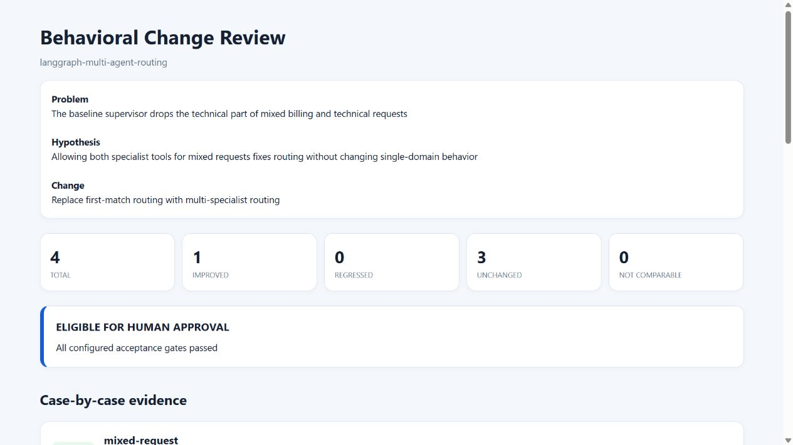
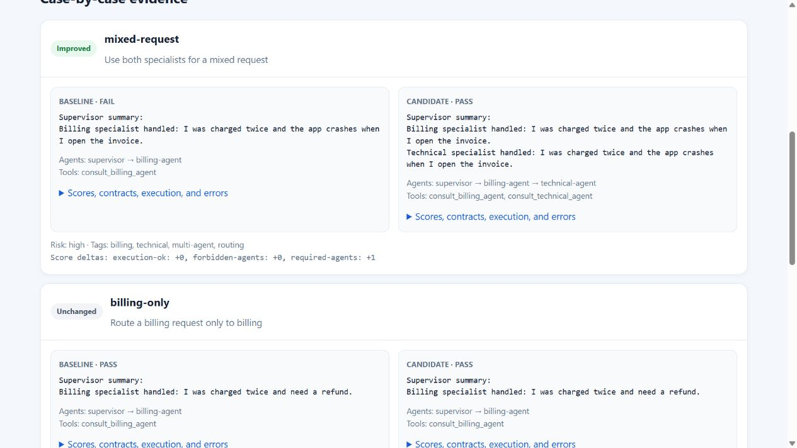
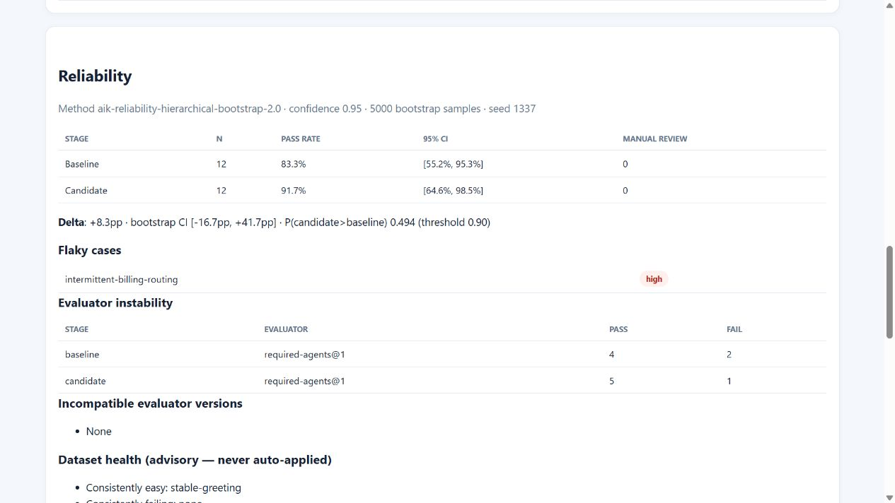
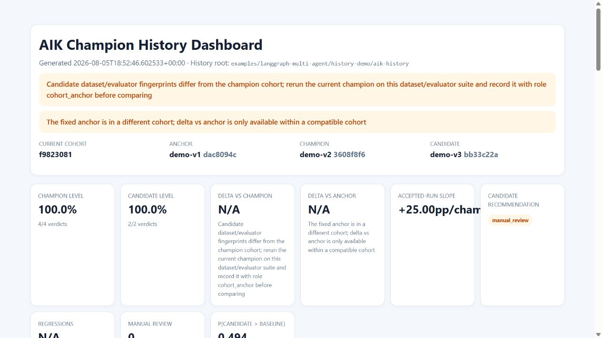

# AIK visual tutorial

This tutorial uses committed synthetic evidence. It makes no API call and requires
only Python 3.10 or newer.

## The scenario

A support supervisor delegates billing and technical work to two specialists. The
baseline handles single-domain questions but sends a mixed billing-and-crash request
only to billing. The candidate changes routing so both specialists participate.

AIK must answer four questions:

1. Did the target behavior improve?
2. Did any previously working behavior regress?
3. Do the configured evaluators and acceptance gates support promotion?
4. Is the apparent improvement repeatable, or could it be noise?

## Build and open the tutorial

From the repository root:

```bash
python scripts/build_showcase.py
python -m http.server 8000 --directory dist/showcase
```

Open `http://127.0.0.1:8000` and use the **Live review** and **Live dashboard**
buttons. Stop the server with `Ctrl+C` when finished.

## 1. Start with governed cases

The demo dataset is
[`examples/langgraph-multi-agent/case/test_cases.jsonl`](../examples/langgraph-multi-agent/case/test_cases.jsonl).
Each case has a stable ID, expected agents, risk, source, split and lifecycle status.
The evaluation policy is defined before the candidate in
[`evaluation.json`](../examples/langgraph-multi-agent/case/evaluation.json).

## 2. Compare the same cases

The baseline and candidate are evaluated independently, then AIK classifies each case
as `improved`, `regressed`, `unchanged` or `not_comparable`.



The mixed request improves because the candidate consults both specialists. The
three single-domain cases remain unchanged, and no regression is hidden behind the
aggregate pass-rate increase.

## 3. Inspect case evidence



The review keeps outputs, agent routing, tool calls, deterministic contracts,
evaluator statuses and execution errors visible for human inspection. `eligible`
means the configured gates passed; it does not mean automatic production approval.

## 4. Check repeatability



The reliability demo repeats two cases six times. A one-shot result looks clean, but
the paired hierarchical bootstrap estimates only `P(candidate > baseline) = 0.494`,
below the configured `0.90` threshold. AIK therefore requires manual review instead
of promoting a noisy candidate.

## 5. Track the champion



The dashboard separates the fixed anchor, current champion and unpromoted candidate.
History artifacts are copied, hashed and checked for tampering. Promotion requires a
compatible cohort, an eligible recommendation and an accepted human decision.

## Rebuild the underlying synthetic evidence

The committed artifacts are ready to inspect. To rebuild them offline:

```bash
python examples/langgraph-multi-agent/history-demo/build_history_demo.py
python examples/langgraph-multi-agent/history-demo/build_reliability_demo.py
python scripts/build_showcase.py
```

These scripts do not invoke LangGraph, an LLM or the network. The separate live
LangGraph demo remains optional and has its own requirements file.

## What this tutorial does not claim

- Statistical gates are supporting evidence, not the sole production-release rule.
- LLM-estimated quality is not real user satisfaction.
- Offline evaluation does not replace production monitoring, security review or
  accountable human release decisions.
